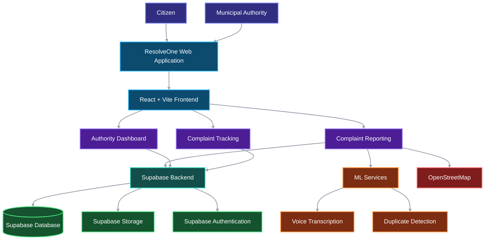
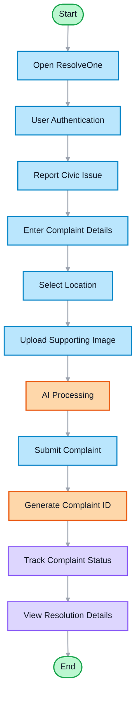
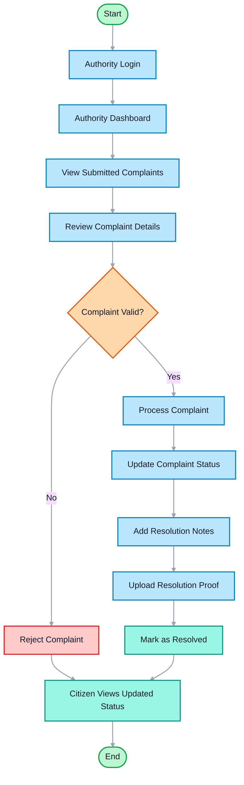
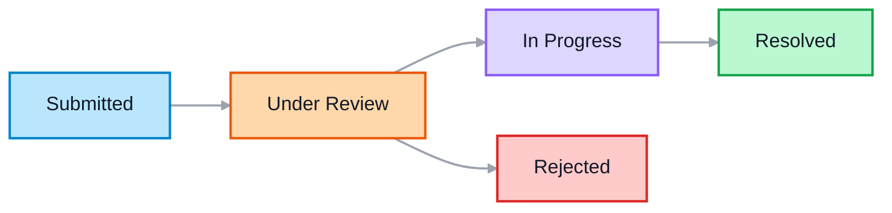

> Current UI: only duplicate suggestions and private following are enabled on the Review step. The isolated multilingual E5 service and Supabase gateway power this feature; the other intelligence panels remain removed. See [duplicate service setup and limits](duplicate_service/README.md). Existing submission, tracking, authority access and Supabase configuration are preserved.

<div align="center">

# ResolveOne

**Intelligence upgrade:** five ML features are integrated into reporting and the authority dashboard. See [the ML service setup guide](ml_service/README.md) for server configuration, the required database migration, model downloads, and verification. Authority access now uses real Supabase accounts; the old demo login is removed. Sarvam credentials belong on the server, not in `VITE_` variables.

**A civic issue reporting and resolution platform that connects citizens with municipal authorities.**

</div>

---

## Overview

Civic infrastructure problems like potholes, broken streetlights, water leaks, garbage often go unreported or unresolved because citizens lack a straightforward channel to reach authorities, and authorities lack visibility into what needs attention.

**ResolveOne** addresses this by providing:

- A **citizen-facing flow** where anyone can verify their identity, describe a civic issue (via text or voice), pin it on a map, attach a photo, and submit it — all without creating an account.
- An **authority dashboard** where municipal officers log in, view all complaints on a list or map, update statuses, add notes, and upload resolution proof photos.
- A **complaint tracking page** where citizens can look up their complaint by code and Aadhaar, see a visual status timeline, and view the resolution photo once the issue is fixed.

---

## Key Features

### Citizen Side

| Feature | Description |
|---|---|
| **Aadhaar-based identity verification** | Citizens enter their 12-digit Aadhaar number to verify identity before reporting. The number is SHA-256 hashed client-side and never stored or transmitted in raw form. |
| **Multi-step complaint reporting** | A guided 4-step wizard: describe the issue → select location on map → attach photo → review and submit. |
| **Voice input (multilingual)** | Citizens can dictate their complaint in English, Hindi, Tamil, Telugu, Malayalam, or Kannada. Audio is transcribed via the Sarvam AI speech-to-text API. |
| **Interactive map location** | Location is auto-detected via browser geolocation. Citizens can drag the marker or tap the map to adjust. Address is reverse-geocoded from OpenStreetMap. |
| **Photo upload** | Citizens can attach a photo of the issue, which is uploaded to Supabase Storage. |
| **Complaint tracking** | Citizens look up complaints using their complaint code and Aadhaar. The page shows complaint details, a visual status timeline, location map, and resolution proof photo. |

### Authority Side

| Feature | Description |
|---|---|
| **Authenticated authority login** | Authorities sign in with email/password via Supabase Auth. Only users with the `authority` role can access the dashboard. |
| **Operations dashboard** | Displays summary statistics (total, open, in-progress, resolved) and all complaints sorted by date. |
| **List and map views** | Authorities can toggle between a list view and a map view showing complaint locations with interactive markers. |
| **Complaint detail view** | Full complaint details including description, category, location map, citizen photo, and status history timeline. |
| **Status updates with notes** | Authorities can change complaint status (Submitted → Under Review → In Progress → Resolved / Rejected) and add notes at each transition. |
| **Resolution proof photo** | When marking a complaint as resolved, authorities must upload a completion proof photo. This photo is visible to citizens on the tracking page. |

### General

| Feature | Description |
|---|---|
| **Dark / light mode** | Theme toggle persisted in localStorage, with system preference detection. |
| **Responsive design** | Mobile-first layout with bottom tab bar on small screens and a full navbar on desktop. |
| **Toast notifications** | User feedback via react-hot-toast for success, error, and warning states. |
| **Error boundary** | Global React error boundary prevents full-page crashes. |

---

## How It Works
## System Architecture

ResolveOne connects citizens and municipal authorities through a centralized platform for reporting, managing, and tracking civic issues. It combines a React-based frontend, Supabase backend services, and ML-powered features to simplify complaint management.

### Architecture Diagram



## How It Works

ResolveOne provides separate workflows for citizens reporting civic issues and municipal authorities managing complaints.

### 1. Citizen Complaint Workflow

Citizens can submit civic complaints by providing issue details, selecting a location, and uploading supporting images. Once submitted, they can track the progress of their complaints.



### 2. Municipal Authority Workflow

Municipal authorities can review submitted complaints, update their status, add resolution details, and provide supporting proof of resolution.



## Complaint Lifecycle

Every complaint moves through a series of stages, allowing citizens to monitor its progress and authorities to maintain transparency.


## Technology Stack

| Component | Technology |
|---|---|
| Frontend | React, Vite |
| Backend | Supabase |
| Database | Supabase PostgreSQL |
| Authentication | Supabase Auth |
| File Storage | Supabase Storage |
| Machine Learning | ML Services |
| Mapping | OpenStreetMap |

## Key Objectives

- Simplify civic issue reporting and complaint submission.
- Improve communication between citizens and municipal authorities.
- Enable transparent complaint tracking.
- Leverage AI-assisted features to improve complaint processing.
- Promote accountability through status updates and resolution records.

---

## Project Structure

```
smart_cities/
├── database/                        # SQL scripts for Supabase setup
│   ├── civicconnect_final.sql       # Complete database schema (idempotent)
│   ├── civicconnect_resolution_bucket.sql
│   ├── fix_get_complaints_by_hash_resolution.sql
│   └── README.md                    # Database setup guide
├── public/
│   ├── favicon.svg
│   └── icons.svg
├── src/
│   ├── components/
│   │   ├── ErrorBoundary.tsx
│   │   └── ui/                      # Reusable UI primitives
│   │       ├── Badge.tsx
│   │       ├── Button.tsx
│   │       ├── Card.tsx
│   │       ├── Input.tsx
│   │       ├── Skeleton.tsx
│   │       └── Spinner.tsx
│   ├── context/
│   │   ├── AuthContext.tsx           # Supabase auth state (authority users)
│   │   ├── CitizenContext.tsx        # Citizen session (hashed Aadhaar)
│   │   └── ThemeContext.tsx          # Dark/light mode
│   ├── layouts/
│   │   ├── Navbar.tsx                # Top navigation (citizen + authority)
│   │   └── BottomTabBar.tsx          # Mobile bottom navigation
│   ├── lib/
│   │   ├── aadhaarHash.ts           # SHA-256 hashing + validation
│   │   └── supabaseClient.ts        # Supabase client initialization
│   ├── pages/
│   │   ├── LandingPage.tsx
│   │   ├── LoginPage.tsx
│   │   ├── RegisterPage.tsx
│   │   ├── AuthorityPage.tsx         # Authority dashboard
│   │   ├── NotFoundPage.tsx
│   │   ├── citizen/
│   │   │   ├── AadhaarVerifyPage.tsx # Aadhaar identity verification
│   │   │   ├── ReportIssuePage.tsx   # Multi-step report wizard
│   │   │   ├── TrackComplaintPage.tsx# Complaint lookup + timeline
│   │   │   ├── ComplaintsPage.tsx    # Citizen complaints list
│   │   │   └── components/          # Step1–4, StepIndicator, ComplaintCard, etc.
│   │   └── authority/
│   │       ├── AuthorityLoginPage.tsx
│   │       └── components/          # StatCards, ComplaintsList, Map, Detail, StatusUpdate
│   ├── router/
│   │   ├── AppRouter.tsx             # Route definitions
│   │   ├── ProtectedRoute.tsx
│   │   └── AuthorityProtectedRoute.tsx
│   └── types/
│       ├── complaint.ts              # ComplaintData, ComplaintRow, StatusHistoryRow
│       └── profile.ts               # Profile, Role
├── index.html
├── package.json
├── tsconfig.json
├── vite.config.ts
└── .env                              # Environment variables (not committed)
```

---

## Environment Variables

Create a `.env` file in the project root:

```env
VITE_SUPABASE_URL=your_supabase_project_url
VITE_SUPABASE_ANON_KEY=your_supabase_anon_key
VITE_ML_API_URL=/api/ml
```

| Variable | Required | Description |
|---|---|---|
| `VITE_SUPABASE_URL` | Yes | Your Supabase project URL |
| `VITE_SUPABASE_ANON_KEY` | Yes | Supabase anonymous/public API key |
| `VITE_ML_API_URL` | No in development | ML API URL; defaults to the Vite `/api/ml` proxy. Configure the API origin or a reverse proxy for production. |

Set `SARVAM_API_KEY` only in `ml_service/.env` for voice input. See the ML service guide for server credentials and startup commands.

> **Note:** The `.env` file is listed in `.gitignore` and should never be committed to version control.

--- 

## Security & Privacy

- **Aadhaar numbers are never stored.** The raw 12-digit Aadhaar is hashed client-side using SHA-256 with a fixed salt via the Web Crypto API. Only the hash is transmitted and stored. The raw number is cleared from React state immediately after hashing.
- **No Aadhaar is sent to any server in plain text.** This is a client-side hash used as a pseudonymous identifier for anti-spam and complaint lookup — not official UIDAI authentication.
- **Citizen sessions are ephemeral.** The hashed identifier is stored only in React state (not localStorage or cookies). Refreshing the page resets the session.
- **Authority access is role-gated.** Supabase Auth with email/password login and a `role` check in the `profiles` table protects the authority dashboard.
- **Row-Level Security (RLS)** is enabled on all database tables, restricting access based on user role and ownership.
- **Storage policies** control who can upload and read complaint photos and resolution photos.

> **Disclaimer:** This is a prototype/academic project. The Aadhaar verification is format-based only (12-digit check) and is not connected to UIDAI's official authentication system.

---


## Optional free-tier photo categories

Photo category suggestions use Gemini 3.5 Flash-Lite through a Supabase Edge Function and require a key from a **billing-disabled free-tier project**. The panel stays hidden until configured. Citizens explicitly consent to sending a resized photo and manually apply suggestions. No paid fallback is configured. See [setup, privacy and free-tier limits](supabase/functions/photo-category/README.md).
